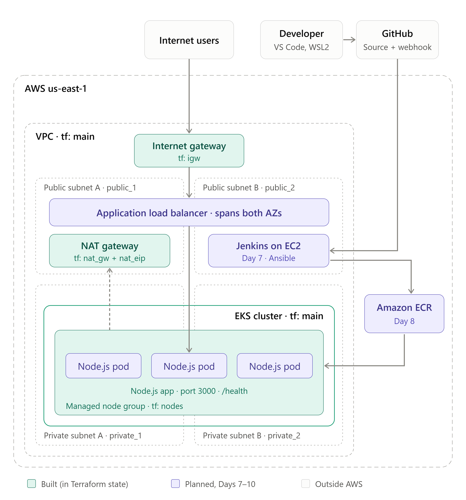

# Automated CI/CD on AWS EKS: GitHub, Jenkins, ECR, and EKS Built with Terraform and Ansible

## Overview
This repository contains a complete, production-grade automated CI/CD pipeline and cloud infrastructure built for a Node.js web application. 

- **Infrastructure as Code:** Provisioned using Terraform with S3 native state locking.
- **Configuration Management:** Jenkins server configured via Ansible.
- **Containerization & Registry:** Docker images tagged by Git commit SHA stored in Amazon ECR.
- **Orchestration:** Deployed to Amazon EKS running across private subnets behind an AWS Application Load Balancer.

---

## 📐 Architecture Overview

The following diagram outlines the system architecture for the EKS CI/CD pipeline, detailing resources provisioned via Terraform (Day 6) and subsequent pipeline components:



---

## 🚦 Roadmap & Implementation Status

### Phase 1: Foundations & Manual Prototyping
- [x] **Day 1:** VS Code, Git & GitHub setup and directory structure initialized.
- [x] **Day 2:** Linux & AWS foundations (IAM, AWS CLI, CloudWatch billing alarms, SSH keys).
- [x] **Day 3:** Custom VPC & Core Networking built manually via AWS Console.
- [x] **Day 4:** NAT Gateways, private subnet route table configuration, and egress validation.
- [x] **Day 5:** Manual EKS infrastructure setup, IAM roles, control plane, and managed node group deployment.

### Phase 2: Infrastructure as Code, CI/CD & Orchestration
- [x] **Day 6:** Terraform infrastructure as code, remote S3 state backend, clean-slate conflict teardown, automated EKS cluster deployment, and GitHub synchronization.
- [x] **Day 7:** Ansible & Jenkins Server Setup, Infrastructure Redeployment, and Automated Provisioning.
- [x] **Day 8:** Jenkins CI/CD Pipeline & ECR Integration.
- [x] **Day 9:** Containerization & Node.js Application Optimization.
- [x] **Day 10:** Persistent Storage (AWS EBS CSI Driver) & Kubernetes Workloads.
- [ ] **Day 11:** Full Pipeline Integration & SRE Practices.
- [ ] **Day 12:** Documentation, Portfolio Polish & Cost Review.

---

## 🏗️ Detailed Project Progress & Implementation Highlights

### ✅ Day 3: Custom VPC & Core Networking Foundations
- **Custom VPC Provisioning:** Deployed `ekscicd-vpc` (`10.0.0.0/16`) with DNS hostnames and DNS resolution enabled.
- **Multi-AZ Subnetting:** Configured 4 subnets across two Availability Zones (`us-east-1a` and `us-east-1b`) split into 2 public and 2 private subnets.
- **Routing & Gateways:** Attached an Internet Gateway (`ekscicd-vpc-igw`), configured public and private route tables, and established an S3 Gateway Endpoint (`ekscicd-vpc-vpce-s3`).
- **Compute Verification:** Launched an Amazon Linux 2023 test VM (`ekscicd-test-vm`) in the public subnet, secured via an IP-restricted Security Group (`ekscicd-test-sg`) and SSH key pair (`ekscicd-key-pair`). End-to-end connectivity verified via WSL2 Ubuntu.
- **Visual Artifacts:** Architecture state and test connectivity captured and logged under `docs/screenshots/`.

### ✅ Day 4: NAT Gateways, Private Subnet Egress & Connectivity Validation
- **NAT Gateway Provisioning:** Deployed `ekscicd-nat-gw` in `ekscicd-vpc-subnet-public1-us-east-1a` with a dedicated Elastic IP (`52.87.219.51`).
- **Private Routing:** Configured private route tables in both Availability Zones with default routes (`0.0.0.0/0`) targeted at `ekscicd-nat-gw` for outbound traffic translation.
- **Private Compute & Security:** Launched `ekscicd-test-private-vm` (`10.0.135.206`) in Private Subnet 1 (`us-east-1a`) with no public IP. Enforced strict security group (`ekscicd-private-test-sg`) allowing SSH access (Port 22) exclusively from the public jump host's security group (`sg-0fbcd3fae17ba3277`).
- **Multi-Hop Access Validation:** Established a secure two-hop access pattern from local WSL2 terminal through the public jump host (`10.0.11.236`) into the private instance using SSH agent forwarding (`-A`).
- **Egress Verification:** Validated outbound connectivity from the private instance, achieving 0% packet loss on ICMP pings to `8.8.8.8` and a successful `HTTP/2 200` response from `aws.amazon.com` via the NAT Gateway.
- **Visual Artifacts:** Terminal output and egress validation captured at `docs/screenshots/04-private-instance-ping.png`.

### ✅ Day 5: Manual EKS Infrastructure & Cluster Setup
- **Core Provisioning:** Completed the manual provisioning of core AWS EKS infrastructure via the AWS CLI to establish foundational networking and control plane security.
- **Provisioned Resources:**
  - **VPC:** `ekscicd-vpc` (`10.0.0.0/16`) with public and private subnets across two Availability Zones.
  - **IAM Roles:** 
    - `ekscicd-eks-cluster-role` with `AmazonEKSClusterPolicy`.
    - `ekscicd-eks-nodegroup-role` with worker node policies.
  - **Security Group:** `ekscicd-eks-cluster-sg` (`sg-061c2e4640ef8bdd6`).
  - **EKS Control Plane:** `ekscicd-eks-cluster` (Kubernetes v1.37, Active).
- **Visual Artifacts:** 
  - `docs/screenshots/ekscicd-day5-vpc-describe.png` — VPC Resource Map architecture view.
  - `docs/screenshots/ekscicd-day5-iam-role.png` — IAM Role permissions and policy attachments.
  - `docs/screenshots/ekscicd-day5-cluster-active.png` — EKS Control Plane active status.
  - `docs/screenshots/ekscicd-day5-nodes-ready.png` — Kubernetes managed worker nodes in `Ready` state.

### ✅ Day 6: Terraform Infrastructure as Code
- **Deliverables:** Codified network foundation, IAM roles, security groups, and EKS v1.37 architecture into Terraform modules. Established remote state storage backed by S3 with native state locking (`use_lockfile = true`). Cleared legacy "Day 5" manual infrastructure conflicts via AWS CLI teardown and achieved a clean-slate deployment (`Apply complete! Resources: 2 added, 0 changed, 0 destroyed.`). Synchronized all codebase and artifact updates to GitHub.
- **Visual Artifacts:** 
  - `docs/screenshots/ekscicd-day6-terraform-init.png` — Terminal output verifying successful `terraform init`.
  - `docs/screenshots/ekscicd-day6-terraform-plan-vpc.png` — Terminal output verifying the VPC Terraform plan.
  - `docs/screenshots/ekscicd-day6-terraform-plan-routes.png` — Terminal output verifying the complete network routes plan.
  - `docs/screenshots/ekscicd-day6-terraform-plan-iam-sg.png` — Terminal output verifying the IAM and security group plan.
  - `docs/screenshots/ekscicd-day6-terraform-plan-eks.png` — Terminal output verifying the complete EKS infrastructure plan.
  - `docs/screenshots/ekscicd-day6-terraform-apply-success.png` — Terminal output verifying the successful clean-slate deployment.
  - `docs/screenshots/ekscicd-day6-git-push.png` — Terminal output verifying successful git commit and push to remote GitHub repository.

### ✅ Day 7: Ansible & Jenkins Server Setup (Milestone 7.3)
- **Overview:** Configured the Jenkins CI/CD controller server automated via Ansible to maintain an idempotent, reproducible configuration across deployment environments.
- **Key Infrastructure & Stack Specifications:**
  - **Host Environment:** AWS EC2 (`t3.medium`, Ubuntu 24.04 LTS) in `us-east-1` (`32.200.120.221`).
  - **Runtime Requirement:** OpenJDK 21 (required by Jenkins LTS).
  - **Automation Engine:** Ansible Playbook (`ansible/jenkins-setup.yml`) managed via inventory (`ansible/inventory.ini`).
  - **Container Engine:** Docker CE (configured with the `jenkins` user added to the `docker` group).
- **Execution & Verification:**
  1. **Ansible Playbook Execution:**
     ```bash
     ansible-playbook -i ansible/inventory.ini ansible/jenkins-setup.yml
     ```
  2. **Service Status Verification:**
     ```bash
     sudo systemctl status jenkins --no-pager
     sudo systemctl status docker --no-pager
     ```
  3. **Troubleshooting & Hardening Handled:**
     - Updated repository configuration to pull the current Jenkins GPG key (`jenkins.io-2026.key`).
     - Configured a Systemd service override (`/etc/systemd/system/jenkins.service.d/override.conf`) setting `JAVA_HOME=/usr/lib/jvm/java-21-openjdk-amd64` to satisfy Java runtime requirements.
- **Visual Artifacts:** 
  - `docs/screenshots/ekscicd-day7-terraform-apply.png`
  - `docs/screenshots/ekscicd-day7-jenkins-instance.png`
  - `docs/screenshots/ekscicd-day7-ansible-run.png`

### ✅ Day 8: Jenkins CI/CD Pipeline & ECR Integration
- **Step 1: Jenkins Web UI Unlock & Initial Access**
  - **Access URL:** `http://32.200.120.221:8080`
  - **Administrative Unlock:** Retrieved initial administrator password from `/var/lib/jenkins/secrets/initialAdminPassword` and successfully unlocked the Jenkins control plane.
  - **Artifact:** `docs/screenshots/ekscicd-day8-jenkins-unlock.png` — Initial web UI unlock and password verification screen.
- **Step 2: Core Pipeline & DevOps Plugin Installation**
  - **Plugin Management:** Completed the initial setup wizard using the suggested plugins installation package, providing core pipeline, Git, and automation tools.
  - **Service Verification:** Verified successful initialization and dashboard access on the Jenkins control plane.
  - **Artifact:** `docs/screenshots/ekscicd-day8-plugins-installed.png` — Active Jenkins dashboard following successful plugin provisioning.
- **Step 3: AWS & GitHub Secure Credential Configuration**
  - **Credential Management:** Configured secure global credentials in Jenkins for AWS ECR/EKS access (`aws-secret-credentials`) and GitHub source code synchronization (`github-token`).
  - **Security Compliance:** Prevented plaintext credential exposure by leveraging Jenkins' built-in encrypted secrets store for pipeline authentication.
  - **Artifact:** `docs/screenshots/ekscicd-day8-credentials.png` — Global credentials manager dashboard verification screen.
- **Step 4: Declarative Pipeline Skeleton (`Jenkinsfile`)**
  - **Pipeline Structure:** Created the foundational `Jenkinsfile` defining multi-stage execution for source checkout, testing, container build/push to ECR, and EKS deployment.
  - **Version Control:** Committed and synchronized the pipeline configuration file to the remote GitHub repository.
  - **Artifact:** `docs/screenshots/ekscicd-day8-jenkinsfile.png` — Declarative pipeline definition script verification screen.

### ✅ Day 9: Containerization & Node.js Application Optimization
- **Infrastructure Restoration & Prerequisites:** Successfully restarted the Jenkins control plane instance (`i-0481ac307587f161f`) and re-provisioned the EKS cluster and VPC via Terraform, verifying that cluster nodes were active and Jenkins was reachable.
  - **Artifact:** `docs/screenshots/ekscicd-day9-infrastructure-restored.png`
- **Containerization & Multi-Stage Dockerfile Setup:** Created a production-grade multi-stage `Dockerfile` and `.dockerignore` configuration within the application directory (`app/`), incorporating an Express server entry point (`index.js`) and configuration (`package.json`).
- **Security Control:** Implemented non-root execution (`USER nodejs`, UID 1001) within a slim Alpine Linux runtime environment (`node:20-alpine`) to minimize attack surfaces and enhance security compliance.
  - **Artifact:** `docs/screenshots/ekscicd-day9-dockerfile.png`
- **Local Build & Runtime Verification:** Built and locally verified the container image using the multi-stage `Dockerfile`, running the container in detached mode mapped to host port `3000` (`docker run -d --name node-app-test -p 3000:3000 cloudpath-node-app:latest`). Verified HTTP responsiveness via `curl http://localhost:3000`, confirming successful initialization under non-root permissions before performing container cleanup.
  - **Artifact:** `docs/screenshots/ekscicd-day9-docker-build.png`

### ✅ Day 10: Persistent Storage (AWS EBS CSI Driver) & Kubernetes Workloads
- **EBS CSI Driver Integration:** Provisioned the Amazon EBS CSI driver add-on (`v1.67.2-eksbuild.1`) via Terraform, linking it to an IAM role (`ekscicd-ebs-csi-driver-role`) configured with `AmazonEBSCSIDriverPolicy` via IRSA (IAM Roles for Service Accounts) to resolve metadata and permission boundaries.
- **Validation of CSI Controllers:** Verified that all EBS CSI controller (`6/6`) and node daemonset (`3/3`) pods initialized successfully and remained healthy in the `kube-system` namespace.
  - **Artifact:** `docs/screenshots/ekscicd-day10-ebs-csi.png`
- **Storage Configuration & Dynamic Provisioning Test:** Created a dynamic `gp3` Kubernetes `StorageClass` (`ebs-gp3-sc`) using the `ebs.csi.aws.com` provisioner with `volumeBindingMode: WaitForFirstConsumer`, alongside a 5Gi `PersistentVolumeClaim` (`app-pvc`) placed in the `k8s/` directory. Verified end-to-end dynamic volume binding and mount validation by deploying and testing a temporary application pod.
  - **Artifacts:** 
    - `docs/screenshots/ekscicd-day10-ebs-csi.png`
    - `docs/screenshots/ekscicd-day10-storage.png`